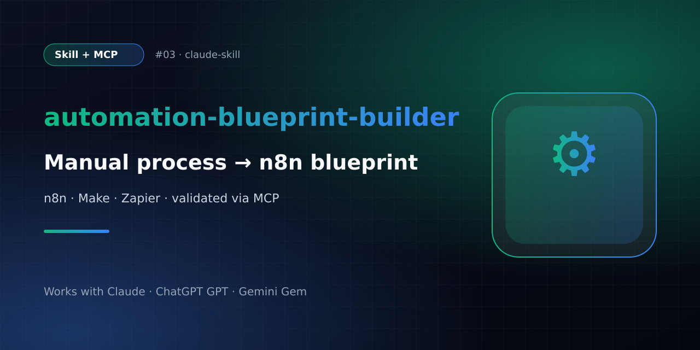

<p align="center"><a href="https://cloudskillhub.com"></a></p>

# automation-blueprint-builder

🌐 **Website:** [cloudskillhub.com](https://cloudskillhub.com) · 📦 **All skills:** [skillhub](https://github.com/jahirulofficial0/skillhub)

Describe a manual business process and get a buildable n8n / Make / Zapier automation blueprint — plus an MCP server that creates and validates the workflow inside your own n8n.

**Works with:** Claude (Code, Desktop, claude.ai) · ChatGPT custom GPT · Gemini Gem

## Install

### Claude Code — this skill only
```
/plugin marketplace add jahirulofficial0/skillhub
/plugin install automation-blueprint-builder@skillhub
```
Or directly from this repo: copy `skills/automation-blueprint-builder/` into `~/.claude/skills/`.

### All 10 skills at once
See **[skillhub](https://github.com/jahirulofficial0/skillhub)** — one marketplace, or one MCP server that serves all 10 skills.

### claude.ai
Download `skills/automation-blueprint-builder/` as a ZIP → **Settings → Capabilities → Skills → Upload skill**.

### ChatGPT / Gemini
- ChatGPT GPT: [`prompts/chatgpt-gpt.md`](prompts/chatgpt-gpt.md)
- Gemini Gem: [`prompts/gemini-gem.md`](prompts/gemini-gem.md)

## MCP server (optional)

This repo includes an MCP server in [`mcp-server/`](mcp-server/).

| Tool | What it does |
|------|--------------|
| `validate_workflow` | Checks workflow JSON structure, node references and connections locally (no network) |
| `list_workflows` | Lists workflows in your n8n |
| `create_workflow` | Creates the workflow in your n8n — always **inactive** |

**Option A — npm (after it is published):**
```json
{
  "mcpServers": {
    "automation-blueprint-builder": {
      "command": "npx",
      "args": ["-y", "@jahirulofficial0/automation-blueprint-builder-mcp"],
      "env": {
        "N8N_BASE_URL": "https://your-n8n.example.com",
        "N8N_API_KEY": "<your n8n API key>"
      }
    }
  }
}
```

**Option B — from source:**
```bash
git clone https://github.com/jahirulofficial0/automation-blueprint-builder.git
cd automation-blueprint-builder/mcp-server
npm install && npm run build
```
Then use `"command": "node", "args": ["/absolute/path/automation-blueprint-builder/mcp-server/dist/index.js"]` with the same `env`.

Secrets are read only from environment variables and are never logged.

## Usage
Just describe the task — the skill activates when relevant. Example:

> Every time someone fills our website contact form, I copy the details into Google Sheets and send them a WhatsApp/email reply manually. ~30 leads/day. Use n8n.

See [`examples/`](examples/) for a full input → output sample.

## What you get
```
## Process Map
| # | Manual step today | Automate? | Node / module |

## Blueprint
Trigger: …
1. Node — app / operation — key mappings
2. …
Error branch: …

## Credentials Needed
| Connection | Scope | Who provides |

## n8n Workflow JSON
```json
{ "name": "...", "nodes": [...], "connections": {...} }
```

## Test Plan
- [ ] Run with sample payload …

## Cost / Volume Estimate
```

## Repository layout
```
.claude-plugin/plugin.json   Claude Code plugin manifest
skills/automation-blueprint-builder/SKILL.md       The skill
prompts/                     ChatGPT GPT and Gemini Gem versions
examples/                    Sample input and output
assets/banner.png            Social preview image
mcp-server/                  MCP server (TypeScript)
```

## Author
**Jahirul** — [cloudskillhub.com](https://cloudskillhub.com) · [github.com/jahirulofficial0](https://github.com/jahirulofficial0)

## License
MIT — see [LICENSE](LICENSE).
